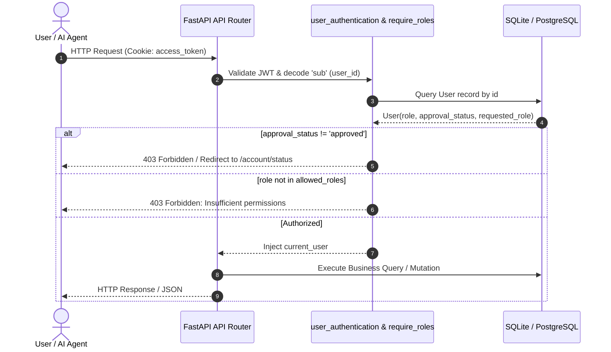
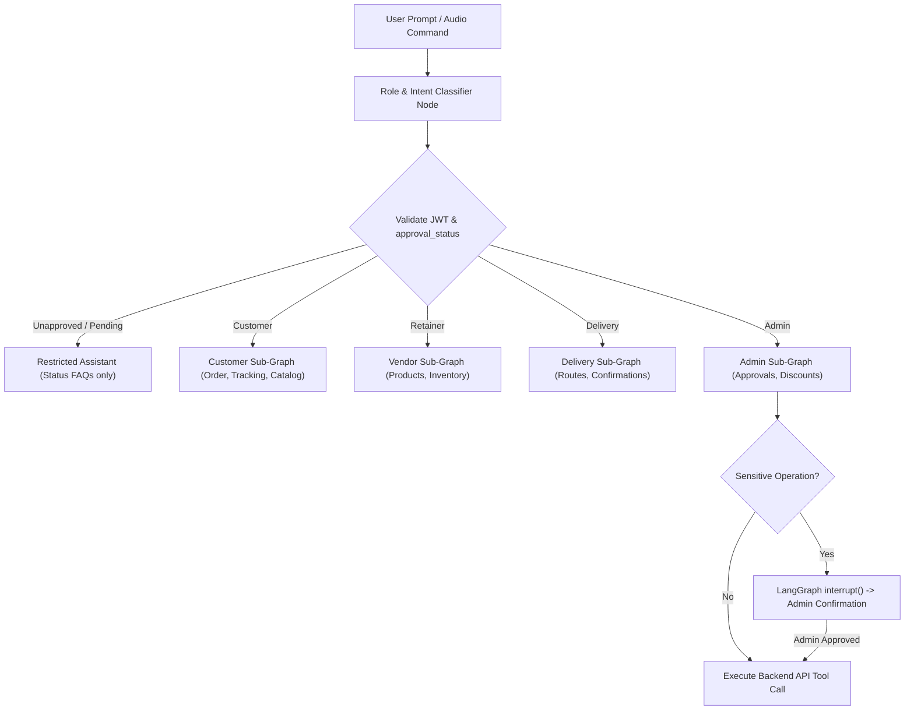

# AI Integration & Architecture Guide – Order Portal

This guide provides technical reference for integrating **LangChain**, **LangGraph**, and **Voice Agent capabilities** into the Order Portal in future phases without installing redundant packages or altering core backend business logic.

---

## 1. Existing Application Architecture

* **Backend Engine**: FastAPI (`0.111.1` on Python 3.14.x) running synchronous SQLAlchemy 2.0 ORM sessions (`get_db` dependency via `SessionLocal`).
* **Database**: SQLite (`data/test.db`), designed for migration to Google Cloud SQL (PostgreSQL).
* **Frontend**: Server-side Jinja2 templates (`Template/`) styled with modular CSS and vanilla JavaScript.
* **Authentication**: Cookie-based JWT authentication (`access_token` stored as HttpOnly, Lax, Secure cookie).
* **Payment Processor**: Stripe PaymentIntents (INR Card) and Cash on Delivery (COD).

---

## 2. Authentication & Authorization Flow



---

## 3. Active Role & Approval Status Design

| Role (`role`) | Self-Registration | Initial Active Role | `approval_status` | `requested_role` | Permissions |
| :--- | :--- | :--- | :--- | :--- | :--- |
| **`user`** | Direct | `user` | `approved` | `None` | Buy products, cancel pending orders, view profile |
| **`retainer`** | Direct | `retainer` | `approved` | `None` | Add products, manage own listings |
| **`admin`** | Approval Required | `user` (safe fallback) | `pending` | `admin` | Restricted until approved by existing Admin |
| **`viewer`** | Approval Required | `user` (safe fallback) | `pending` | `viewer` | Restricted until approved by existing Admin |
| **`delivery`** | Approval Required | `user` (safe fallback) | `pending` | `delivery` | Restricted until approved by existing Admin |

---

## 4. Existing Business APIs (Future AI Tool Bindings)

AI agents will invoke these existing endpoints as tools using the caller's JWT token context.

### Customer Tools (`role == 'user'`)
| Tool Name | Existing Endpoint | Method | Input Parameters | Output Response |
| :--- | :--- | :---: | :--- | :--- |
| `get_personal_orders` | `/products/get-orders/{user_id}` | `GET` | `user_id: int` | `List[OrderResponse]` |
| `create_order` | `/order` | `POST` | `product_id: int, quantity: int` | Redirect / Status |
| `cancel_pending_order` | `/orders/cancel/{o_id}` | `POST` | `o_id: int` | Flash / Redirect |
| `get_customer_profile` | `/profile` | `GET` | None (reads token) | Profile HTML / Dict |

### Vendor Tools (`role == 'retainer'`)
| Tool Name | Existing Endpoint | Method | Input Parameters | Output Response |
| :--- | :--- | :---: | :--- | :--- |
| `add_product` | `/addproduct` | `POST` | `title, description, price, discount, quantity, category` | Redirect / Product Model |
| `get_vendor_products` | `/admin/profiles` (Vendor section) | `GET` | None | Products linked to vendor ID |

### Delivery Agent Tools (`role == 'delivery'`)
| Tool Name | Existing Endpoint | Method | Input Parameters | Output Response |
| :--- | :--- | :---: | :--- | :--- |
| `get_pending_deliveries` | `/delivery/orders` | `GET` | None | Unfulfilled orders + shipping addresses |
| `mark_order_delivered` | `/delivery/mark-delivered/{order_id}` | `POST` | `order_id: int` | Redirect with success flash |

### Administrator Tools (`role == 'admin'`)
| Tool Name | Existing Endpoint | Method | Input Parameters | Output Response |
| :--- | :--- | :---: | :--- | :--- |
| `list_role_requests` | `/admin/role-requests` | `GET` | None | Pending applicant requests |
| `approve_role_request` | `/admin/role-requests/{user_id}/approve` | `POST` | `user_id: int` | Flash / Redirect |
| `reject_role_request` | `/admin/role-requests/{user_id}/reject` | `POST` | `user_id: int` | Flash / Redirect |
| `update_discount` | `/updatediscount` | `POST` | `category: str, discount: int` | Redirect |

### Auditor Tools (`role == 'viewer'`)
| Tool Name | Existing Endpoint | Method | Input Parameters | Output Response |
| :--- | :--- | :---: | :--- | :--- |
| `trace_all_orders` | `/viewer/orders` | `GET` | None | Global order ledger |
| `audit_all_profiles` | `/admin/profiles` | `GET` | None | All customer & vendor profiles |

---

## 5. Recommended Architecture for Future LangChain & LangGraph Integration



### Proposed Directory Layout for AI Layer
```text
Order-portal/
├── ai/
│   ├── __init__.py
│   ├── graph.py             # LangGraph state machine workflow
│   ├── state.py             # TypedDict state carrying user_id, role, approval_status
│   ├── tools/
│   │   ├── customer.py      # Bindings to /order, /orders/cancel
│   │   ├── vendor.py        # Bindings to /addproduct
│   │   ├── delivery.py      # Bindings to /delivery/mark-delivered
│   │   └── admin.py         # Bindings to /admin/role-requests
│   └── voice/
│       ├── websocket.py     # FastAPI WebSocket endpoint for voice streams
│       └── tts_stt.py       # Speech-to-Text and Text-to-Speech client adapters
```

---

## 6. Strict Security Boundaries & Governance Rules

1. **No Raw SQL Execution**: The LLM must **never** receive raw database credentials, SQL execution tools, or direct query privileges. All persistence must pass through FastAPI dependencies and validated SQLAlchemy models.
2. **Authoritative Backend RBAC**: The LLM prompt or output cannot grant permissions. The backend dependency (`require_roles`) validates the caller's JWT token on every tool execution.
3. **Prompt Injection Hardening**: Output from tool calling must be escaped and structured in JSON prior to being provided back into the agent context.
4. **Human-in-the-Loop (HITL)**: Any operation altering inventory, platform discounts, or approving role requests must require explicit user confirmation before commitment.
